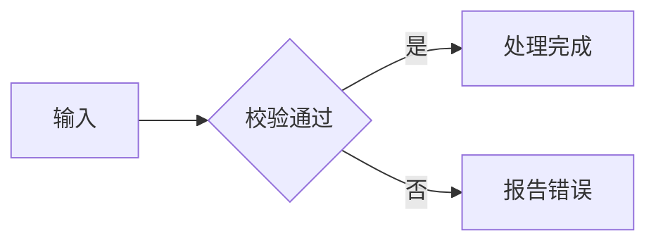

# Hidewnd Docs

基于 Astro 的轻量个人技术博客。现有文章继续保存在 `documents/`，构建时由 Astro Content Collections 直接读取，不需要复制或改写原文。

## 技术栈

- Astro 7 + TypeScript
- Astro Content Collections
- 原生 CSS 与少量原生 JavaScript
- HarmonyOS Sans SC 自托管字体（astro-font 预加载与回退字体）
- Astro Icon + Tabler 构建期图标
- Astro Expressive Code + 行号插件
- astro-compress（HTML/CSS/JS 压缩）
- astro-pagefind（纯静态全文搜索）
- astro-og-canvas（文章预览图）+ astro-robots-txt（自动生成 robots.txt）
- GitHub Actions + GitHub Pages

## 本地开发

```powershell
npm install
npm run dev
```

构建与类型检查：

```powershell
npm run build
```

## 内容约定

文章沿用当前 frontmatter：

```yaml
---
title: 文章标题
date: 2026-08-17 12:00:00
permalink: /doc/d0012/
author:
  name: hidewnd
  link: https://github.com/hidewnd
---
```

目录与站点分类的映射集中在 `src/lib/content.ts`。友链集中在 `src/lib/site.ts`，新增链接只需要补充 `friendLinks` 数组。

迁移文章中的 `:::tip` 会渲染为提示块；旧主题遗留的 `<script>` 与 `<style>` 会在 Markdown 渲染阶段移除，避免将旧 Vue 脚本带进静态页面。

### 流程图与公式

使用 `mermaid` 围栏代码块编写流程图，也可使用 Mermaid 原生支持的时序图等图表：

````markdown

````

流程图只在包含图表的文章中按需加载 Mermaid，跟随站点明暗主题。图表过宽时可在容器内横向滚动；禁用 JavaScript 时保留源码，加载或语法错误会显示提示及原文。

行内公式使用 `$...$`，块级公式使用独立行的 `$$`，也支持 `math` 围栏代码块：

````markdown
行内公式：$E = mc^2$。

$$
\sum_{i=1}^{n} i = \frac{n(n+1)}{2}
$$

```math
\begin{pmatrix} a & b \\ c & d \end{pmatrix}
```
````

普通美元符号写成 `\$`，例如 `价格为 \$5`。行内代码和普通代码块中的 `$` 不会被解析为公式。公式采用 KaTeX 支持的语法，在构建时输出 HTML 与 MathML，样式和字体随站点发布，无需客户端公式脚本。公式语法错误会保留原文，悬停可查看错误信息；不支持的命令以错误颜色显示。

Markdown 插件顺序及 HTML 清理规则集中在 `src/plugins/markdown.mjs`，站点和回归测试共用。测试使用 Node 内置测试运行器：`npm run test:markdown`。

## 主题与字体

颜色令牌参考旧 Vdoing 站点的蓝青配色，集中维护在 `src/styles/global.css`。首页背景与头像位于 `src/assets/`，通过 Astro 资源管线引用（构建时生成带哈希的文件名以利于缓存更新）；页面图标仅在构建期从 Tabler 图标集中提取，不加载客户端图标脚本。

项目自托管未修改的 `HarmonyOS Sans SC Regular` 字体，完整授权文件位于 `public/fonts/HarmonyOS_Sans_LICENSE.txt`。根据字体授权要求，页脚保留了字体使用声明；字体文件未做子集化或格式转换。字体加载由 `astro-font` 的 `<AstroFont>` 组件统一管理（`@font-face`、`preload` 预加载与基于度量自动生成的回退字体），集中在 `src/layouts/BaseLayout.astro`，不要在全局样式中手写 `@font-face`。

## 搜索、预览图与 SEO

- **搜索**：`astro-pagefind` 在构建后对 `dist` 建立全文索引，`src/pages/search/index.astro` 使用其组件化 UI（`pagefind-input` / `pagefind-summary` / `pagefind-results`）。顶部搜索框提交 `/search/?q=` 后由页面脚本预填查询词。组件配色通过 `global.css` 中映射到语义令牌的 `--pf-*` 变量控制。
- **文章预览图**：`astro-og-canvas` 在 `src/pages/og/[...slug].ts` 为每篇文章生成 1200×630 的 PNG，`og:image` 与 Twitter 卡片元数据在 `BaseLayout` 统一输出。
- **robots.txt**：由 `astro-robots-txt` 在构建时自动生成，不再维护 `public/robots.txt`。
- **压缩**：`astro-compress` 压缩构建产物中的 HTML/CSS/JS（图片已为 webp，跳过图片重压缩）。

Astro 开发工具栏在 `astro.config.mjs` 中以项目级配置关闭，避免本地预览和截图被工具栏遮挡。

普通 Markdown 代码块由 `astro-expressive-code` 统一渲染，语言归一化集中在 `src/plugins/remark-admonitions.mjs`，行号、Shiki 语法高亮、复制按钮和明暗主题配置集中在 `ec.config.mjs`。不要在单篇文章中复制代码块脚本或样式。

## GitHub Pages 部署

推送到 `main` 后，`.github/workflows/deploy.yml` 会自动构建并部署。仓库 Settings → Pages 的 Source 需要选择 **GitHub Actions**。

当前站点配置使用自定义域名 `hidewnd.com`，因此 `public/CNAME` 已包含该域名，`astro.config.mjs` 不设置仓库子路径 `base`。若以后改为 `https://<user>.github.io/<repo>/`，需要同时调整 `site`、`base` 与站内链接策略。
