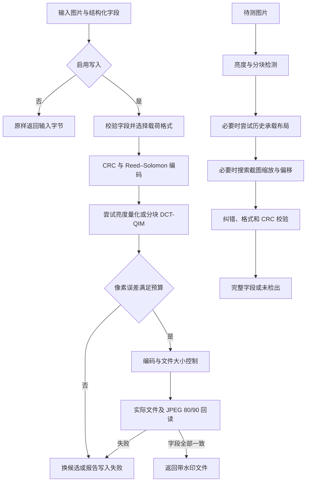

# 图像隐藏水印：算法原理、载荷格式与完整 Python 实现

本文给出一套纯 CPU 图像水印的完整参考实现：把结构化字段编码为带纠错的二进制码字，再通过小幅像素修改写入图片；检测时只输入待测图片，不需要原图、在线数据库或模型文件。文末单个 Python 代码块同时包含载荷编解码、两条嵌入路径、压缩、盲检测、命令行和自测。

水印承载的是字段的二进制表示，并非 JSON 文本。检测成功后返回 JSON 对象。`source` 是双方约定的静态标签，**没有存储在码字中**；时间戳和可选标识才从像素信号恢复。示例不提供加密、数字签名或身份认证。

## 1. 整体流程与参数



图中的检测阶段一旦成功就立即返回。图片读取错误、依赖缺失和写入失败通过异常报告，不转换成“未检出”。PNG 文本块、EXIF 文本和文件名不参与载荷恢复。

| 参数 | 取值 | 用途 |
|---|---:|---|
| DCT 分块边长 $N$ | 32 像素 | 原尺寸分块变换 |
| 每块系数对数量 | 32 | 每块承载 32 个位观测 |
| QIM 步长 $\Delta$ | 16、24、32 | 从较低强度开始尝试 |
| 每档最大修正次数 | 5 | 补偿整像素舍入和裁剪 |
| RGB RMS 上限 | 1 个灰阶 | 相当于归一化后的 $1/255$ |
| 完整载荷 | 192 字节 | 148 字节数据含 CRC，44 字节纠错 |
| 紧凑载荷 | 96 或 128 字节 | 52 或 84 字节数据含 CRC，44 字节纠错 |
| 系数配对种子 | 20261103 | PCG64，固定排列 |
| 位或字节交织种子 | 20261104 | PCG64，固定映射 |
| 分块量化抖动种子 | 20261105 | PCG64，均匀分布 $[-0.5,0.5)$ |
| 单批完整块数 | 至多 128 | 限制 DCT 中间张量大小 |
| 有限承载区 | 至多 2048 个完整块 | 控制大图计算量与扰动区域 |

上述参数定义本文的协议和实现策略，不能把固定种子换成任意随机数后仍期待互相读取。PCG64 的原始随机流约定与 `Generator` 高层操作的兼容范围也不同，因此安装示例固定 NumPy 版本；变更版本后应执行兼容验证。[PCG64 文档](https://numpy.org/doc/stable/reference/random/bit_generators/pcg64.html)、[随机数兼容策略](https://numpy.org/doc/stable/reference/random/compatibility.html)。

## 2. 载荷格式与纠错

### 2.1 字段契约

| 字段 | 含义与限制 |
|---|---|
| `source` | 必须等于静态常量 `SOURCE`，默认 `"example"`；不占用载荷空间 |
| `timestamp` | 正整数 Unix 秒时间戳，范围 $1\le t<2^{64}$，布尔值无效 |
| `group_id` | 可选非空字符串，UTF-8 编码后至多 64 字节 |
| `user_id` | 可选非空字符串，UTF-8 编码后至多 64 字节 |

不适用的标识省略，不写 `null` 或空字符串，不截断或哈希替代。编码器拒绝其他字段。时间戳表达调用者提供的时间；构建函数未收到时间戳时取当前 Unix 秒数，解码器不据此判断真实性。

修改 `SOURCE` 不改变编码字节，但会改变同一张图片解码后返回的 `source`。因此不能把它解释为从图片取出的可变文本，也不能根据它认定作者身份。若需要保存任意来源文本，须另行定义载荷版本；本文不扩展该字段。

多字节整数统一使用大端序。码字通过 `unpackbits` 按字节内高位优先转为位序列。CRC 覆盖版本头、字段和零填充，使用 `zlib.crc32(body)`，返回的无符号 32 位整数以大端序追加。[Python CRC 文档](https://docs.python.org/3.12/library/zlib.html#zlib.crc32)。

### 2.2 固定格式 v2：192 字节

| 字节偏移 | 长度 | 内容 |
|---:|---:|---|
| 0–3 | 4 | 标识 `57 42 50 02` |
| 4–11 | 8 | 时间戳 |
| 12 | 1 | 第一个标识的 UTF-8 字节数 |
| 13 | 1 | 第二个标识的 UTF-8 字节数 |
| 14–77 | 64 | 第一个标识，未用字节为零 |
| 78–141 | 64 | 第二个标识，未用字节为零 |
| 142–143 | 2 | 保留零字节 |
| 144–147 | 4 | 前 144 字节的 CRC |
| 148–191 | 44 | Reed–Solomon 校验符号 |

即使两个标识都缺省，该格式仍为 192 字节。全部填充和保留字节必须为零。

### 2.3 紧凑格式 v3：96 或 128 字节

| 字节偏移 | 长度 | 内容 |
|---:|---:|---|
| 0–3 | 4 | 标识 `57 42 50 03` |
| 4–11 | 8 | 时间戳 |
| 12、13 | 各 1 | 两段标识的**存储**字节数 |
| 14 | 1 | 两个 2 位模式，最高 4 位为零 |
| 15 起 | 变长 | 依次存储两个标识，再补零 |
| 数据区末尾 | 4 | 之前全部数据字节的 CRC |
| 码字末尾 | 44 | Reed–Solomon 校验符号 |

96 字节格式的主体长度为 48，CRC 位于 48–51，两个标识合计最多占 33 个存储字节；128 字节格式的主体长度为 80，CRC 位于 80–83，可用标识空间为 65 字节。选择能够容纳内容的较小格式，两档都放不下则报告容量不足。

模式位 0–1 对应第一个标识，位 2–3 对应第二个标识：

| 模式 | 编码 |
|---:|---|
| 0 | 原始 UTF-8 字节 |
| 1 | 偶数长度的小写十六进制文本，每两个字符打包成一个字节 |
| 2 | 偶数长度的大写十六进制文本，解码后恢复为大写 |
| 3 | 无效，拒绝 |

只包含数字时使用模式 1；混合大小写、奇数长度及非十六进制字符串使用模式 0。先检查原始 UTF-8 长度，再压缩，不能用打包绕过 64 字节限制。前导零会保留。零长度标识只能使用模式 0；解码后再次检查还原长度、UTF-8、保留位和零填充。

### 2.4 历史格式 v1：128 字节

v1 的标识为 `57 42 50 01`：时间戳占 4–11，单个标识长度位于 12，数据位于 13–76，77–79 为零填充，80–83 为 CRC，84–127 为 44 个纠错符号。它只包含一个可选标识，不生成 `user_id`。本文写入器不生成 v1，检测器保留读取能力。

**载荷版本和像素承载算法是两个维度。** 例如 v2 码字可由分块或历史整图布局承载；不能只看码字长度推断使用了哪种频域算法。长度同为 128 字节的 v1、v3 还须依据标识和结构区分。

### 2.5 Reed–Solomon 与 CRC 的职责

采用 $GF(2^8)$，每个符号为一个字节；参考代码使用 `prim=0x11d`、`generator=2`、`fcr=0` 的库默认参数。44 个校验符号对应的确定性纠错条件为：

$$
2e+v\le44
$$

其中 $e$ 为位置未知的错误字节数，$v$ 为位置已标出的擦除字节数。无擦除时可纠正至多 22 个错误字节；只有擦除时可恢复至多 44 字节。这个上界按**字节**计算，而不是按位计算。[原始论文](https://epubs.siam.org/doi/10.1137/0108018)、[reedsolo 说明](https://github.com/tomerfiliba-org/reedsolomon)。

超过纠错范围时不能只相信解码器没有抛异常。接收端还须检查长度、版本、字段边界、UTF-8、填充和 CRC。CRC 用于筛除错误候选，不能证明未经伪造；公开算法、固定抖动和公开常量也不是密码密钥。

## 3. 分块 DCT-QIM 嵌入

### 3.1 亮度与正交 DCT

将图片转换为 8 位亮度 $X$。RGB 到亮度近似为 $0.299R+0.587G+0.114B$，实际整数转换由 Pillow 完成。对每个 $N\times N$ 完整块定义：

$$
C_{u,x}=\alpha_u\cos\!\left[\frac{\pi u(x+1/2)}{N}\right],\qquad
\alpha_0=\frac1{\sqrt N},\quad
\alpha_u=\sqrt{\frac2N}\ (u>0)
$$

$$
F=CXC^\mathsf{T},\qquad X=C^\mathsf{T}FC
$$

这是正交归一化的二维 DCT-II，参考其基础定义可见 [DCT 论文](https://doi.org/10.1109/T-C.1974.223784)。代码中 `C` 对应 `_basis`，系数和矩阵使用 `float32`。

候选坐标满足 $1\le u,v\le15$ 且 $6\le u+v\le16$。先按 `u`、`v` 升序枚举，再用 PCG64 种子 20261103 的 `shuffle` 打乱；前 32 个坐标记为 $a_j$，其后 32 个记为 $b_j$，同下标组成一对。64 个位置互不重复。

### 3.2 纹理权重与平坦区保护

令掩码 $M_{u,v}$ 在 $u+v\ge4$ 且不属于上述 64 个承载系数时为 1，其余为 0。定义纹理强度及权重：

$$
s=\sqrt{\frac1{N^2}\sum_{u,v}M_{u,v}F_{u,v}^2},\qquad
w=\operatorname{clip}\!\left(\frac{s-2}{6},0,1\right)
$$

低频渐变及 DC 不参与纹理判定。纯色块的 $w=0$，不写入水印，也不提供检测证据。缓慢渐变并非无条件不变：只有其掩码内能量不超过阈值时才不写入。排除承载系数可减轻水印修改对纹理判定自身的影响。

### 3.3 位映射与量化格

块按行扫描，每块按系数对下标扫描。设码字有 $L$ 位，普通布局用种子 20261104 得到排列 $P$，第 $k$ 个观测对应 $P[k\bmod L]$。同一位可在多个块重复出现。大图有限承载区采用每轮独立的 `permuted(..., axis=1)`，避免相同位总落在同一空白列。

种子 20261105 按观测矩阵形状生成抖动，展平后记为 $\eta_k\sim U[-0.5,0.5)$。对一对系数，令差值 $d=F_a-F_b$，写入位 $b\in\{0,1\}$ 时：

$$
q_b(d)=\Delta\left[\operatorname{rint}\!\left(\frac d\Delta-\eta-\frac b2\right)+\eta+\frac b2\right]
$$

$$
d^\star=d+w\,[q_b(d)-d]
$$

`rint` 对恰好位于中点的值采用偶数舍入。两个位使用相差半个步长的量化格；$w<1$ 时只向目标格移动一部分，并不声称每次都已精确落格。QIM 的基本思想及失真、容量和鲁棒性的取舍见 [QIM 论文](https://ieeexplore.ieee.org/document/923725/)。本文的系数选择、权重、分支和回读策略是这里明确给出的组合定义。

对当前读回的差值 $d_t$，做等量反向修正：

$$
\delta_t=\frac{d^\star-d_t}{2},\qquad
F_a\leftarrow F_a+\delta_t,\quad F_b\leftarrow F_b-\delta_t
$$

将系数修正逆变换回空间域，同量加到 R、G、B 三通道，再舍入和裁剪到 0–255。一次整数化可能没有达到目标差值，因此每档最多修正 5 次；目标 $d^\star$ 固定，每次重新测量实际像素。依次尝试步长 16、24、32，每档从原图重新开始，不累积上一档的扰动。

### 3.4 容量、有限承载区与画质预算

完整块数为：

$$
B=\left\lfloor\frac W{32}\right\rfloor\left\lfloor\frac H{32}\right\rfloor,
\qquad B_{\min}=\left\lceil\frac{8n}{32}\right\rceil
$$

$n$ 是码字字节数：192、128、96 字节分别至少需要 48、32、24 个完整块。写入器在 $B\ge48$ 时用固定格式，否则尝试紧凑格式。容量成立只是必要条件，还必须有足够可写纹理，并通过压缩后的校验。

大图最多使用顶部 2048 个完整块。通常保留整幅宽度并截取整数块行；一行就超过 2048 块时，只使用左上角 2048 块。右侧和底部不足一块的区域不参与嵌入。DCT 每批至多 128 块，但完整图片及输出缓冲仍占 $O(WH)$ 内存，不能理解为总内存恒定。

在实际承载区计算 RGB RMS：

$$
\operatorname{RMS}=\sqrt{\frac1{3W_cH_c}\sum_{x,y,c}(I'_{x,y,c}-I_{x,y,c})^2}\le1
$$

$W_c,H_c$ 是承载区域尺寸。这样不会用长图未写入的区域摊薄误差。它约束的是**编码前、水印自身造成的实际整数像素变化**；随后 JPEG 编码或文件预算缩放仍可能带来额外损失。RMS 通过也不等于所有背景上都不可见，仍需查看平坦背景、渐变、小字和边缘。

## 4. 浅色恒定区域的亮度量化

亮度分支使用 8×8 小块，且仅在其父级 32×32 块有纹理、该小块亮度恒定、均值 $m\ge245$ 时参与写入。父级纯色块整体跳过，因此不会在大片纯色背景上凭空铺设格子。

8×8 正交 DCT 的 DC 系数为 $F_{0,0}=8m$。把均值量化到指定整数奇偶类：

$$
m_b=\operatorname{clip}\!\left(2\operatorname{rint}\!\left(\frac{m-b}{2}\right)+b,\ b,\ 254+b\right)
$$

选中小块的三个通道整体加上 $m_b-m$，最多改变一个灰阶；其他小块保持不动。位判决基于 $\cos(\pi m)$ 的正负。为使没有证据的位集中到少量 RS 符号内，这条路径先排列 192 个**字节**，再保留每字节内 8 位的顺序。

几何上至少需要 1536 个 8×8 小块，即 96 个父级完整块；可用亮色小块仍可能不足。仅固定格式尝试此分支：成功就采用，失败再尝试 DCT-QIM。JPEG 读取时还会尝试原生 Y 通道，减轻 YCbCr 转 RGB 的截断对均值奇偶的影响。[Pillow 图像格式文档](https://pillow.readthedocs.io/en/stable/handbook/image-file-formats.html)。

恒定块的亮度奇偶对重采样很敏感。通过 JPEG 80／90 回读不代表能通过缩放截图；后述截图搜索针对分块 DCT-QIM，不恢复这条亮度分支的缩放同步。

## 5. 检测、截图同步与软纠错

### 5.1 原尺寸软判决

对差值 $d_k$、抖动 $\eta_k$ 和权重 $w_k$，令 $i_k$ 为第 $k$ 个观测对应的载荷位下标，即代码中的 `indices`；普通布局中 $i_k=P[k\bmod L]$。定义：

$$
e_k=w_k\cos\!\left[2\pi\left(\frac{d_k}{\Delta}-\eta_k\right)\right],\qquad
S_\ell=\sum_{k:\,i_k=\ell}e_k
$$

$S_\ell<0$ 判为 1，否则判为 0。连续证据比逐块硬投票保留了更多量化距离信息。检测器依次尝试亮度分支、分块的候选步长、全图重复布局、历史整图布局，最后才进入截图搜索；任何路径都须恢复有效码字。

### 5.2 历史整图布局

将亮度图用 Lanczos 重采样至 256×256，对频率索引从 8 开始的行、列计算 DCT 系数；列数为 32，v2 使用 48 行，v1 使用前 32 行。抖动使用种子 20261103，形状为 48×32，步长为 48：

$$
\hat b_{r,c}=\operatorname{rint}\!\left[2\left(\frac{F_{r,c}}{48}-\eta_{r,c}\right)\right]\bmod2
$$

先检验 192 字节码字，再检验其前 128 字节。该路径只用于检测，写入器不使用整图变换。

### 5.3 截图定位与插值可靠性

截图可能同时改变比例、边缘位置和像素值。即使知道原尺寸，简单放大回去也未必能恢复原分块位置。检测器使用重复位证据定位，不读取原图或已知 JSON。

对候选尺寸 $W_c,H_c$，用比例 $s$ 和中心参数 $c_x,c_y$ 定义输出坐标到输入截图坐标的映射：

$$
x_s=sx+c_x-sW_c/2,\qquad y_s=sy+c_y-sH_c/2
$$

重采样使用 Pillow 的双三次仿射变换。这里 $s$ 表示截图尺寸相对于候选原尺寸的比例。插值对大系数更敏感，使用系数幅值修正可靠性：

$$
r_k=\frac{w_k}{8+\max(|F_{a,k}|,|F_{b,k}|)},\qquad
\tilde e_k=r_k\cos\!\left[2\pi\left(\frac{d_k}{\Delta}-\eta_k\right)\right]
$$

对重复位累加后，使用一致性评分：

$$
R=\frac{\sum_\ell S_\ell^2}{\sum_k\tilde e_k^2+10^{-12}}
$$

互不相关的证据通常给出接近 1 的评分；同一位在多块上同向时，评分会上升。这只是搜索指标，不是概率、置信度证书或水印存在的充分条件。

| 阶段 | 搜索及停止条件 |
|---|---|
| 前置条件 | 顶部预览须有纹理；候选原尺寸宽度不超过 2048，有限承载区至少有 192 个完整块 |
| 基础比例 | 依次为 $1,5/6,0.8,0.75,2/3,0.5,1.25,1.5,2$ |
| 粗搜索 | 比例 1 不加比例偏差，其他比例试 $-0.001,0,+0.001$；水平偏移 −3 至 3，垂直偏移 −4 至 3，均为整数像素 |
| 预览 | 高度至多 512；同时比较三个 QIM 步长，每个基础比例只保留评分最高的候选 |
| 进入细化 | 粗评分至少 1.25；使用完整有限承载区，固定胜出的 QIM 步长 |
| 细化步距 | 比例／位移分别为 $(0.0002,0.2)$、$(0.00005,0.05)$、$(0.00001,0.01)$ |
| 细化过程 | 三个参数逐坐标尝试步距的 −2、−1、+1、+2 倍；每档至多 5 轮，无改善即结束该档 |
| 最终尝试 | 细评分至少 2 才调用软纠错；全部候选失败则返回未检出 |

这些是有限的候选搜索，不等价于支持任意缩放、旋转、透视变换或任意裁剪。它针对重复的固定长度分块载荷，不为紧凑载荷执行专门的截图定位。未检出图片也可能遍历多个候选，因此耗时可以显著高于原图检测。

### 5.4 擦除与有限候选试读

首先直接用 RS 解码硬判决码字。失败后，以每个字节中最小的 $|S_\ell|$ 作为不确定程度，依次将最不确定的 8、16、24、32、40、44 个字节作为擦除位置。

若仍失败，取最不确定的 12 个位，分别翻转一个或两个位，最多测试：

$$
\binom{12}{1}+\binom{12}{2}=78
$$

个候选。该步骤利用软信息尝试跨过临界错误，但不提高 RS 的保证纠错上界，也不枚举标识或时间戳。每个候选仍执行完整 RS、格式和 CRC 校验；不会根据部分字段返回成功。

## 6. 输入输出、压缩与能力边界

| 项目 | 参考实现的行为 |
|---|---|
| 写入格式 | 静态 PNG、JPEG；新像素编码后再次验证 |
| 检测格式 | 静态 PNG、JPEG、WebP |
| 输入大小 | 至多 50 MiB，即 $50\times1024^2$ 字节；同时保留 Pillow 的像素解压保护 |
| 原文件 ≤ 5,000,000 字节 | `compress_image` 原样返回字节 |
| PNG > 5,000,000 且 ≤ 8,000,000 | 无损重编码，保留有效候选中较小者，不强制压到 5 MB |
| JPEG ≤ 8,000,000 | 保留原始编码，不为达到 5 MB 再做有损编码 |
| 文件仍 > 8,000,000 | PNG 保持格式缩放；JPEG 先试质量 90、85、80，再缩放；每轮从原图重采样 |
| 新 JPEG 像素 | 先按质量 95、4:4:4 编码，必要时才进入上述压缩路径 |
| 写入验收 | 实际输出文件、JPEG 90 和 80（4:2:0）必须全部恢复相同字段 |

压缩阈值是示例处理策略，不是水印算法的理论要求。长度按实际文件字节计算，MB 与 MiB 不能混用。PNG 优化和 JPEG 有损编码的参数含义见 [Pillow 文档](https://pillow.readthedocs.io/en/stable/handbook/image-file-formats.html)。

颜色处理以 8 位 RGB／RGBA 为主要使用范围。读取时应用 EXIF 方向，写入保留 alpha 和 ICC 字节；不会执行 ICC 色彩空间转换，也不保证其他颜色模式转换后完全保真。改变透明图的合成背景、颜色管理或亮度曲线后，检测结果需要另测。一般文本元数据不作为输出保留承诺。

若文件预算要求缩放，水印也可能随重采样失效；写入器此时会报告失败，不返回伪装成成功的无水印图。可以先用 `compress_image` 调整原图，再对调整后的尺寸写入。关闭水印时只原样返回，压缩需单独调用。

推荐复用一个 `WatermarkProcessor` 串行处理多张图片。它的同步接口复用变换矩阵，不提供并发调度。矩阵批处理限制中间张量，图片解码、RGB 副本、输出编码和截图搜索仍需 CPU 与内存。不能据单个样本声称所有图片满足某个延迟目标。

## 7. 安装、接口和命令

参考解释器为 Python 3.12；NumPy 2.5.4 要求 Python 3.12 或更高版本。安装到用于运行脚本的同一解释器环境：

```sh
python3.12 -m venv .venv
.venv/bin/python -m pip install "numpy==2.5.4" "Pillow==12.3.0" "reedsolo==1.7.0"
```

将下一节的整个 Python 代码块保存为 `watermark.py`。程序只有这一个源码文件。接口如下，其中图片均以 `bytes` 传递：

```text
build_provenance(*, timestamp=None, group_id=None, user_id=None) -> Provenance
WatermarkProcessor.apply_hidden_watermark(image_bytes, provenance, *, enabled=False) -> bytes
WatermarkProcessor.decode_hidden_watermark(image_bytes) -> Provenance | None
compress_image(image_bytes) -> bytes
```

`build_provenance` 只构建字段，字段校验在编码入口进行。字段不合法或紧凑编码空间不足时抛 `ValueError`；无法读取的图片抛 `WatermarkImageError`；算法依赖缺失、完整块数量不足、缺少纹理或画质预算内无法完成写入时抛 `WatermarkProcessingError`。

```sh
# 生成中性样本，并把参考图和报告写到指定目录。
.venv/bin/python watermark.py self-test --runs 30 --output-dir demo-output

# 写入固定示例时间和可选标识。省略 timestamp 则使用当前 Unix 秒数。
.venv/bin/python watermark.py embed demo-output/sample-original.png marked.png --timestamp 1700000000 --group-id 000123 --user-id example-user

# 仅凭待测文件恢复字段；也可把输入换为截图。
.venv/bin/python watermark.py detect marked.png
```

检测成功的示例输出为：

```json
{
  "source": "example",
  "timestamp": 1700000000,
  "group_id": "000123",
  "user_id": "example-user"
}
```

没有有效载荷时输出“未检出有效隐藏水印”。命令退出码：成功为 0，未检出为 2，参数、读取、写入或自测错误为 1。`self-test` 的 `passed` 只表示基础必检项通过；`display_transforms_reference_only` 单独记录显示变换的恢复结果，允许为 `false`。

## 8. 完整 Python 实现

代码中公式对应关系：`_initialize_transform` 定义 DCT 和配对；`_analyze` 计算纹理权重；`_embed_candidate` 实现 QIM 与 RMS 预算；`_embed_luminance` 实现亮度量化；`_extract_payload` 汇总软证据；`_screenshot_scores` 计算截图一致性评分；`_decode_screenshot_scores` 执行有限软纠错。

```python
"""纯 CPU 图像水印：载荷编码、嵌入、盲检测与离线自测。"""
from __future__ import annotations

import argparse
from collections.abc import Iterator
from io import BytesIO
from itertools import combinations
import json
from math import sqrt
from pathlib import Path
import struct
import sys
from time import time, perf_counter, process_time
from typing import Any, cast, TypedDict, NotRequired
import warnings
import zlib

from PIL import Image, ImageOps, UnidentifiedImageError

SOURCE: str = "example"
DATA_BYTES = 148
PARITY_BYTES = 44
PAYLOAD_BYTES = DATA_BYTES + PARITY_BYTES
LEGACY_PAYLOAD_BYTES = 128
MAGIC = bytes.fromhex("57 42 50 02")
COMPACT_MAGIC = bytes.fromhex("57 42 50 03")
COMPACT_PAYLOAD_BYTES = (96, 128)
COMPRESSION_THRESHOLD = 5_000_000
MAX_OUTPUT_BYTES = 8_000_000


MAX_WATERMARK_INPUT_BYTES = 50 * 1024 * 1024


BLOCK_SIZE = 32


BITS_PER_BLOCK = 32


PAYLOAD_BITS = PAYLOAD_BYTES * 8


MAX_BATCH_BLOCKS = 128


MAX_CARRIER_BLOCKS = 2048


QUANTIZATION_STEPS = (16.0, 24.0, 32.0)


MAX_PIXEL_RMS = 1.0  # 8 位 RGB 的 1 个灰阶，即归一化后的 1/255。


MAX_EMBED_PASSES = 5


LEGACY_FRAME_SIZE = 256


LEGACY_COLUMNS = 32


LEGACY_ROWS = PAYLOAD_BITS // LEGACY_COLUMNS


LEGACY_QUANTIZATION_STEP = 48.0


SCREENSHOT_SCALES = (1.0, 5 / 6, .8, .75, 2 / 3, .5, 1.25, 1.5, 2.0)


MAX_SCREENSHOT_WIDTH = 2048


class Provenance(TypedDict):
    source: str
    timestamp: int
    group_id: NotRequired[str]
    user_id: NotRequired[str]


def build_provenance(
    *, timestamp: int | None = None, group_id: str | None = None, user_id: str | None = None,
) -> Provenance:
    """构建载荷；不适用的标识省略，字段合法性在编码入口校验。"""
    result: Provenance = {"source": SOURCE, "timestamp": int(time()) if timestamp is None else timestamp}
    if group_id is not None:
        result["group_id"] = group_id
    if user_id is not None:
        result["user_id"] = user_id
    return result


def encode_provenance(provenance: Provenance, *, compact: bool = False) -> bytes:
    """在写入边界校验字段；不适用的标识省略，不截断、哈希或补空值。"""
    if set(provenance) - {"source", "timestamp", "group_id", "user_id"}:
        raise ValueError("水印载荷只能包含 source、timestamp 和可选 group_id、user_id")
    if provenance.get("source") != SOURCE:
        raise ValueError(f"水印来源必须与全局标记 SOURCE 一致：{SOURCE}")
    timestamp = provenance.get("timestamp")
    if type(timestamp) is not int or not 0 < timestamp < 2**64:
        raise ValueError("水印 timestamp 必须为正整数 Unix 秒时间戳")
    identifiers: list[bytes] = []
    for field in ("group_id", "user_id"):
        value = b""
        if field in provenance:
            identifier = provenance.get(field)
            if not isinstance(identifier, str) or not identifier:
                raise ValueError(f"水印 {field} 必须为非空字符串；不适用时省略该字段")
            value = identifier.encode("utf-8")
            if len(value) > 64:
                raise ValueError(f"水印 {field} 超过 64 个 UTF-8 字节")
        identifiers.append(value)
    from reedsolo import RSCodec

    if compact:
        # 小卡片不为两个 ID 各预留 64 字节。同大小写的十六进制 ID 可无损
        # 半字节打包；大小写、前导零都由模式位保留，其他 UTF-8 原样存储。
        flags = 0
        for index, identifier in enumerate(identifiers):
            if identifier and len(identifier) % 2 == 0:
                for mode, alphabet in ((1, b"0123456789abcdef"), (2, b"0123456789ABCDEF")):
                    if all(value in alphabet for value in identifier):
                        identifiers[index] = bytes.fromhex(identifier.decode("ascii"))
                        flags |= mode << (index * 2)
                        break
        group, user = identifiers
        body = struct.pack(">4sQBBB", COMPACT_MAGIC, timestamp, len(group), len(user), flags) + group + user
        payload_bytes = next((size for size in COMPACT_PAYLOAD_BYTES if len(body) + 4 <= size - PARITY_BYTES), None)
        if payload_bytes is None:
            raise ValueError("图片容量不足，小卡片无法容纳完整群和用户 ID；不会截断或替换字段")
        body = body.ljust(payload_bytes - PARITY_BYTES - 4, b"\0")
    else:
        # 保持已生成图片的固定布局：版本 4 + 时间戳 8 + 长度 2 + ID 区 128 + 保留 2 + CRC 4。
        group, user = identifiers
        body = struct.pack(">4sQBB64s64s2x", MAGIC, timestamp, len(group), len(user), group, user)
        payload_bytes = PAYLOAD_BYTES
    data = body + struct.pack(">I", zlib.crc32(body))
    return bytes(RSCodec(PARITY_BYTES, nsize=payload_bytes).encode(data))


def decode_provenance(payload: bytes, *, erase_positions: list[int] | None = None) -> Provenance | None:
    """纠错、版本、填充和 CRC 均有效才返回 JSON，不用部分字段猜测来源。"""
    from reedsolo import RSCodec, ReedSolomonError

    if len(payload) not in (*COMPACT_PAYLOAD_BYTES, LEGACY_PAYLOAD_BYTES, PAYLOAD_BYTES):
        return None
    try:
        data, _, _ = RSCodec(PARITY_BYTES, nsize=len(payload)).decode(payload, erase_pos=erase_positions)
    except ReedSolomonError:
        return None
    data = bytes(data)
    body, crc = data[:-4], data[-4:]
    if len(data) != len(payload) - PARITY_BYTES or struct.pack(">I", zlib.crc32(body)) != crc:
        return None
    if body[:4] == COMPACT_MAGIC:
        if len(payload) not in COMPACT_PAYLOAD_BYTES:
            return None
        _, timestamp, group_length, user_length, flags = struct.unpack(">4sQBBB", body[:15])
        end = 15 + group_length + user_length
        if flags & 0xF0 or end > len(body) or any(body[end:]):
            return None
        identifiers = [body[15:15 + group_length], body[15 + group_length:end]]
        for index, identifier in enumerate(identifiers):
            mode = (flags >> (index * 2)) & 3
            if mode == 3 or (mode and not identifier):
                return None
            if mode:
                restored = identifier.hex()
                identifiers[index] = (restored.upper() if mode == 2 else restored).encode("ascii")
        group, user = identifiers
        group_length, user_length = len(group), len(user)
    elif len(payload) == LEGACY_PAYLOAD_BYTES:
        magic, timestamp, group_length, group = struct.unpack(">4sQB64s3x", body)
        if magic != bytes.fromhex("57 42 50 01") or any(body[77:]):
            return None
        user_length, user = 0, b""
    elif len(payload) == PAYLOAD_BYTES:
        magic, timestamp, group_length, user_length, group, user = struct.unpack(">4sQBB64s64s2x", body)
        if magic != MAGIC or any(body[142:]):
            return None
    else:
        return None
    if timestamp == 0 or group_length > 64 or user_length > 64 or any(group[group_length:]) or any(user[user_length:]):
        return None
    provenance: Provenance = {"source": SOURCE, "timestamp": timestamp}
    try:
        if group_length:
            provenance["group_id"] = group[:group_length].decode("utf-8")
        if user_length:
            provenance["user_id"] = user[:user_length].decode("utf-8")
    except UnicodeDecodeError:
        return None
    return provenance


class WatermarkImageError(ValueError):
    """输入图片无法读取或不在支持范围内。"""


class WatermarkProcessingError(RuntimeError):
    """算法依赖或写入失败；不得当作未检出或成功写入。"""


class WatermarkProcessor:

    def __init__(self) -> None:
        self._basis: Any = None
        self._pair_a: Any = None
        self._pair_b: Any = None
        self._texture_mask: Any = None
        self._permutation: Any = None
        self._luminance_permutation: Any = None
        self._legacy_basis: Any = None
        self._legacy_dither: Any = None

    def _initialize_transform(self) -> None:
        if self._basis is not None:
            return
        try:
            import numpy as np
            import reedsolo  # noqa: F401
        except ImportError as exc:
            raise WatermarkProcessingError(
                "缺少算法依赖，请安装 numpy==2.5.4 和 reedsolo==1.7.0"
            ) from exc
        positions = np.arange(BLOCK_SIZE, dtype=np.float32)[None, :] + .5
        frequencies = np.arange(BLOCK_SIZE, dtype=np.float32)[:, None]
        self._basis = (np.cos(np.pi * frequencies * positions / BLOCK_SIZE) * np.sqrt(2 / BLOCK_SIZE)).astype(np.float32)
        self._basis[0] /= np.sqrt(2)
        coordinates = np.array([(u, v) for u in range(1, 16) for v in range(1, 16) if 6 <= u + v <= 16])
        np.random.Generator(np.random.PCG64(20261103)).shuffle(coordinates)
        self._pair_a, self._pair_b = coordinates[:BITS_PER_BLOCK], coordinates[BITS_PER_BLOCK:2 * BITS_PER_BLOCK]
        # 纹理判断排除载荷系数和缓慢渐变，避免水印自身把纯色区域误判为可写区域。
        self._texture_mask = (np.arange(BLOCK_SIZE)[:, None] + np.arange(BLOCK_SIZE)[None, :] >= 4).astype(np.float32)
        self._texture_mask[self._pair_a[:, 0], self._pair_a[:, 1]] = 0
        self._texture_mask[self._pair_b[:, 0], self._pair_b[:, 1]] = 0
        # 固定交织和抖动只用于分散信号，不是密钥或防伪认证；修改种子会改变解码协议。
        self._permutation = np.random.Generator(np.random.PCG64(20261104)).permutation(PAYLOAD_BITS).astype(np.int32)
        # 浅色小块按字节交织，把缺失证据集中在 RS 符号内，才能作为擦除纠错。
        order = np.random.Generator(np.random.PCG64(20261104)).permutation(PAYLOAD_BYTES)
        self._luminance_permutation = (order[:, None] * 8 + np.arange(8)).ravel().astype(np.int32)

    def _block_parameters(
        self, size: tuple[int, int], *, staggered: bool = False, payload_bits: int = PAYLOAD_BITS,
    ) -> tuple[Any, Any]:
        import numpy as np
        width, height = size
        count = (width // BLOCK_SIZE) * (height // BLOCK_SIZE)
        permutation = self._permutation if payload_bits == PAYLOAD_BITS else np.random.Generator(
            np.random.PCG64(20261104),
        ).permutation(payload_bits).astype(np.int32)
        indices = permutation[np.arange(count * BITS_PER_BLOCK).reshape(count, BITS_PER_BLOCK) % payload_bits]
        if staggered:
            # 长图若每轮沿用同一排列，24 块宽等布局会让部分位始终落在空白列。
            # 每轮独立交织；顺序仅依赖固定种子和尺寸，JPEG 转码后仍可盲读取。
            cycles = np.broadcast_to(np.arange(payload_bits, dtype=np.int32), (
                (count * BITS_PER_BLOCK + payload_bits - 1) // payload_bits, payload_bits,
            ))
            shuffled = np.random.Generator(np.random.PCG64(20261104)).permuted(cycles, axis=1)
            indices = shuffled.ravel()[:count * BITS_PER_BLOCK].reshape(count, BITS_PER_BLOCK)
        dither = np.random.Generator(np.random.PCG64(20261105)).uniform(-.5, .5, indices.shape).astype(np.float32)
        return indices, dither

    def _analyze(self, image: Image.Image) -> tuple[Any, Any]:
        import numpy as np
        count = (image.width // BLOCK_SIZE) * (image.height // BLOCK_SIZE)
        differences = np.empty((count, BITS_PER_BLOCK), dtype=np.float32)
        weights = np.empty(count, dtype=np.float32)
        luminance = np.asarray(image.convert("L"))
        for start, stop, rows, columns in _block_batches(image.size):
            blocks = luminance[rows, columns].reshape(BLOCK_SIZE, stop - start, BLOCK_SIZE).transpose(1, 0, 2).astype(np.float32)
            coefficients = self._basis @ blocks @ self._basis.T
            differences[start:stop] = (
                coefficients[:, self._pair_a[:, 0], self._pair_a[:, 1]]
                - coefficients[:, self._pair_b[:, 0], self._pair_b[:, 1]]
            )
            texture = np.sqrt(np.sum(coefficients ** 2 * self._texture_mask, axis=(1, 2)) / BLOCK_SIZE ** 2)
            weights[start:stop] = np.clip((texture - 2) / 6, 0, 1)
        return differences, weights

    def _extract_payload(
        self, differences: Any, weights: Any, indices: Any, dither: Any, step: float, *, payload_bits: int = PAYLOAD_BITS,
    ) -> bytes:
        import numpy as np
        # 各块重复承载交织后的位；软判决保留量化距离和纹理权重，不让平坦块的噪声投票。
        evidence = np.cos(2 * np.pi * (differences / step - dither)) * weights[:, None]
        scores = np.bincount(indices.ravel(), weights=evidence.ravel(), minlength=payload_bits)
        return np.packbits((scores < 0).astype(np.uint8)).tobytes()

    def _analyze_luminance(self, image: Image.Image, parent_weights: Any = None) -> tuple[Any, Any]:
        import numpy as np
        luminance = np.asarray(image.convert("L"))
        count = (image.width // 8) * (image.height // 8)
        means = np.empty(count, dtype=np.float32)
        flat = np.empty(count, dtype=np.bool_)
        for start, stop, rows, columns in _block_batches(image.size, block_size=8):
            blocks = luminance[rows, columns].reshape(8, stop - start, 8).transpose(1, 0, 2)
            means[start:stop] = np.mean(blocks, axis=(1, 2))
            flat[start:stop] = np.max(blocks, axis=(1, 2)) == np.min(blocks, axis=(1, 2))
        if parent_weights is None:
            _, parent_weights = self._analyze(image)
        # 纯色和渐变的整个 32×32 块仍不写入；仅使用文字块内恒定、明亮的 8×8 小块。
        weights = np.repeat(np.repeat(parent_weights.reshape(image.height // 32, image.width // 32), 4, axis=0), 4, axis=1).ravel()
        weights *= flat & (means >= 245)
        return means, weights

    def _decode_luminance(self, image: Image.Image) -> Provenance | None:
        import numpy as np
        width, height = _carrier_size(image.size)
        size = (width // BLOCK_SIZE * BLOCK_SIZE, height // BLOCK_SIZE * BLOCK_SIZE)
        if size[0] * size[1] // 64 < PAYLOAD_BITS:
            return None
        carrier = image if size == image.size else image.crop((0, 0, *size))
        means, weights = self._analyze_luminance(carrier)
        if not np.any(weights):
            return None
        indices = self._luminance_permutation[np.arange(len(means)) % PAYLOAD_BITS]
        scores = np.bincount(indices, weights=np.cos(np.pi * means) * weights, minlength=PAYLOAD_BITS)
        payload = np.packbits(scores < 0).tobytes()
        recovered = decode_provenance(payload)
        if recovered is not None:
            return recovered
        # 没有覆盖或证据抵消的字节交给 RS 擦除恢复；仍须通过全部格式和 CRC 校验。
        missing = np.flatnonzero(np.min(np.abs(scores).reshape(-1, 8), axis=1) < .001).tolist()
        return decode_provenance(payload, erase_positions=missing) if 0 < len(missing) <= PARITY_BYTES else None

    def _embed_luminance(self, original: Image.Image, weights: Any, payload: bytes, provenance: Provenance) -> Image.Image | None:
        import numpy as np
        size = (original.width // BLOCK_SIZE * BLOCK_SIZE, original.height // BLOCK_SIZE * BLOCK_SIZE)
        if size[0] * size[1] // 64 < PAYLOAD_BITS:
            return None
        carrier = original if size == original.size else original.crop((0, 0, *size))
        means, sub_weights = self._analyze_luminance(carrier, weights)
        if not np.any(sub_weights):
            return None
        indices = self._luminance_permutation[np.arange(len(means)) % PAYLOAD_BITS]
        bits = np.unpackbits(np.frombuffer(payload, dtype=np.uint8))[indices].astype(np.float32)
        # 8×8 的亮度均值即 DC 系数 / 8。整数奇偶格在 JPEG 80/90 下可保留，
        # 恒定小块只需整体增减一个灰阶，不生成中频波纹，也不修改文字像素。
        targets = np.rint((means - bits) / 2) * 2 + bits
        targets = np.clip(targets, bits, 254 + bits)
        deltas = (targets - means).astype(np.int16)
        deltas[sub_weights == 0] = 0
        source = np.asarray(carrier)
        pixels = np.array(source)
        squared_error = 0.0
        for start, stop, rows, columns in _block_batches(size, block_size=8):
            blocks = pixels[rows, columns].reshape(8, stop - start, 8, 3).transpose(1, 0, 2, 3)
            before = blocks.astype(np.int16)
            changed = np.clip(before + deltas[start:stop, None, None, None], 0, 255)
            squared_error += float(np.sum((changed - before) ** 2, dtype=np.float64))
            blocks[:] = changed
        if squared_error / source.size > MAX_PIXEL_RMS ** 2:
            return None
        candidate = Image.fromarray(pixels)
        if self._decode_luminance(candidate) != provenance:
            return None
        if size != original.size:
            output = original.copy()
            output.paste(candidate, (0, 0))
            return output
        return candidate

    def _decode_blocks(
        self, image: Image.Image, steps: tuple[float, ...] = QUANTIZATION_STEPS, *, legacy_full_image: bool = False,
    ) -> Provenance | None:
        capacity = (image.width // BLOCK_SIZE) * (image.height // BLOCK_SIZE) * BITS_PER_BLOCK
        sizes = (PAYLOAD_BYTES,) if capacity >= PAYLOAD_BITS else COMPACT_PAYLOAD_BYTES
        sizes = tuple(size for size in sizes if capacity >= size * 8)
        if not sizes:
            return None
        size = image.size if legacy_full_image else _carrier_size(image.size)
        carrier = image if size == image.size else image.crop((0, 0, *size))
        differences, weights = self._analyze(carrier)
        # 小图依次试可容纳的两档完整载荷，依旧通过 RS、版本和 CRC 才认定成功。
        for payload_bytes in sizes:
            payload_bits = payload_bytes * 8
            indices, dither = self._block_parameters(size, staggered=size != image.size, payload_bits=payload_bits)
            for step in steps:
                recovered = decode_provenance(self._extract_payload(
                    differences, weights, indices, dither, step, payload_bits=payload_bits,
                ))
                if recovered is not None:
                    return recovered
        return None

    def apply_hidden_watermark(self, image_bytes: bytes, provenance: Provenance, *, enabled: bool = False) -> bytes:
        """启用后返回通过最终编码与 JPEG 回读验证的图片；关闭时原样返回。"""
        if not enabled:
            return image_bytes
        return self._apply(image_bytes, provenance)

    def decode_hidden_watermark(self, image_bytes: bytes) -> Provenance | None:
        """有效载荷返回字典，未检出返回 None，图片读取或依赖错误向外报告。"""
        return self._decode(image_bytes)

    def _apply(self, image_bytes: bytes, provenance: Provenance) -> bytes:
        image, image_format = _read_image(image_bytes, writing=True)
        self._initialize_transform()
        import numpy as np

        capacity = (image.width // BLOCK_SIZE) * (image.height // BLOCK_SIZE) * BITS_PER_BLOCK
        compact = capacity < PAYLOAD_BITS
        payload = encode_provenance(provenance, compact=compact)
        payload_bits = len(payload) * 8
        if capacity < payload_bits:
            raise WatermarkProcessingError(
                f"图片容量不足，当前完整载荷至少需要 {payload_bits // BITS_PER_BLOCK} 个完整的 32×32 像素块"
            )
        original = image.convert("RGB")
        size = _carrier_size(original.size)
        carrier = original if size == original.size else original.crop((0, 0, *size))
        source_pixels = np.asarray(carrier)
        before, weights = self._analyze(carrier)
        if not np.any(weights):
            raise WatermarkProcessingError("图片缺少可承载隐藏水印的纹理，保留平坦背景")
        indices, dither = self._block_parameters(size, staggered=size != image.size, payload_bits=payload_bits)
        bits = np.unpackbits(np.frombuffer(payload, dtype=np.uint8))[indices].astype(np.float32)
        for step in (QUANTIZATION_STEPS if compact else (None, *QUANTIZATION_STEPS)):
            candidate = self._embed_luminance(carrier, weights, payload, provenance) if step is None else self._embed_candidate(
                carrier, source_pixels, before, weights, indices, dither, bits, step, provenance, payload_bits=payload_bits,
            )
            if candidate is None:
                continue
            if size != original.size:
                marked = original.copy()
                marked.paste(candidate, (0, 0))
                candidate = marked
            if "A" in image.getbands():
                candidate.putalpha(image.getchannel("A"))
            candidate.info["icc_profile"] = image.info.get("icc_profile")
            # 对最终编码结果验证，避免仅验证尚未压缩的像素。
            result = _encode_image(candidate, image_format)
            final, _ = _read_image(result)
            recovered = self._decode_luminance(final) if step is None else self._decode_blocks(final, (step,))
            if recovered != provenance:
                continue
            for quality in (90, 80):
                jpeg = BytesIO()
                final.convert("RGB").save(jpeg, format="JPEG", quality=quality, subsampling=2)
                if step is None:
                    recovered = self._decode_luminance(_jpeg_luminance(jpeg.getvalue()))
                else:
                    with Image.open(jpeg) as probe:
                        recovered = self._decode_blocks(probe, (step,))
                if recovered != provenance:
                    break
            else:
                return result
        raise WatermarkProcessingError("当前图片无法在画质预算内写入可通过原图与 JPEG 80/90 校验的隐藏水印")

    def _embed_candidate(
        self, original: Image.Image, source_pixels: Any, before: Any, weights: Any,
        indices: Any, dither: Any, bits: Any, step: float, provenance: Provenance, *, payload_bits: int = PAYLOAD_BITS,
    ) -> Image.Image | None:
        import numpy as np
        quantized = step * (np.rint(before / step - dither - bits * .5) + dither + bits * .5)
        target = before + (quantized - before) * weights[:, None]
        pixels = np.array(source_pixels)
        current = before
        for _ in range(MAX_EMBED_PASSES):
            squared_error = 0.0
            for start, stop, rows, columns in _block_batches(original.size):
                correction = np.zeros((stop - start, BLOCK_SIZE, BLOCK_SIZE), dtype=np.float32)
                delta = (target[start:stop] - current[start:stop]) / 2
                correction[:, self._pair_a[:, 0], self._pair_a[:, 1]] = delta
                correction[:, self._pair_b[:, 0], self._pair_b[:, 1]] = -delta
                spatial_delta = self._basis.T @ correction @ self._basis
                # 连续块行用视图写回，避免高级索引为 RGB 读写重复复制整批像素。
                blocks = pixels[rows, columns].reshape(BLOCK_SIZE, stop - start, BLOCK_SIZE, 3).transpose(1, 0, 2, 3)
                original_blocks = source_pixels[rows, columns].reshape(BLOCK_SIZE, stop - start, BLOCK_SIZE, 3).transpose(1, 0, 2, 3)
                changed = np.clip(np.rint(blocks.astype(np.float32) + spatial_delta[:, :, :, None]), 0, 255).astype(np.uint8)
                blocks[:] = changed
                difference = changed.astype(np.float32) - original_blocks
                squared_error += float(np.sum(difference ** 2, dtype=np.float64))
            # 预算约束实际承载区域，不能靠长图未写入的其余部分摊薄误差。
            # 边缘不足一块的像素不修改，其误差为零。
            if squared_error / source_pixels.size > MAX_PIXEL_RMS ** 2:
                return None
            output = Image.fromarray(pixels)
            current, actual_weights = self._analyze(output)
            recovered = self._extract_payload(current, actual_weights, indices, dither, step, payload_bits=payload_bits)
            if decode_provenance(recovered) == provenance:
                return output
        return None

    def _decode(self, image_bytes: bytes) -> Provenance | None:
        image, image_format = _read_image(image_bytes)
        self._initialize_transform()
        recovered = self._decode_luminance(image)
        if recovered is None and image_format == "JPEG":
            recovered = self._decode_luminance(_jpeg_luminance(image_bytes))
        if recovered is None:
            recovered = self._decode_blocks(image)
        if recovered is None and _carrier_size(image.size) != image.size:
            # 同时支持全图重复布局和有限承载区域布局。
            recovered = self._decode_blocks(image, legacy_full_image=True)
        if recovered is not None:
            return recovered
        import numpy as np
        if self._legacy_basis is None:
            positions = np.arange(LEGACY_FRAME_SIZE, dtype=np.float32)[None, :] + .5
            frequencies = np.arange(8, 8 + LEGACY_ROWS, dtype=np.float32)[:, None]
            self._legacy_basis = (np.cos(np.pi * frequencies * positions / LEGACY_FRAME_SIZE) * np.sqrt(2 / LEGACY_FRAME_SIZE)).astype(np.float32)
            self._legacy_dither = np.random.Generator(np.random.PCG64(20261103)).uniform(
                -.5, .5, (LEGACY_ROWS, LEGACY_COLUMNS),
            ).astype(np.float32)
        frame = np.asarray(image.convert("L").resize((LEGACY_FRAME_SIZE, LEGACY_FRAME_SIZE), Image.Resampling.LANCZOS), dtype=np.float32)
        coefficients = self._legacy_basis @ frame @ self._legacy_basis[:LEGACY_COLUMNS].T
        bits = (np.rint(2 * (coefficients / LEGACY_QUANTIZATION_STEP - self._legacy_dither)).astype(np.int32) % 2).astype(np.uint8)
        payload = np.packbits(bits).tobytes()
        provenance = decode_provenance(payload)
        # 前 32×32 个频点和抖动序列保持不变，因此已生成的 v1 图片仍可读取。
        if provenance is None:
            provenance = decode_provenance(payload[:LEGACY_PAYLOAD_BYTES])
        return provenance if provenance is not None else self._decode_screenshot(image)

    def _screenshot_scores(
        self, image: Image.Image, size: tuple[int, int], position: Any, indices: Any, dither: Any,
        steps: tuple[float, ...],
    ) -> tuple[float, float, Any]:
        """重复载荷的一致程度用于盲定位，不依赖原图、已知 JSON 或图片元数据。"""
        import numpy as np
        scale, center_x, center_y = position
        matrix = (scale, 0, center_x - scale * size[0] / 2, 0, scale, center_y - scale * size[1] / 2)
        pixels = np.asarray(image.transform(size, Image.Transform.AFFINE, matrix, Image.Resampling.BICUBIC))
        differences = np.empty(indices.shape, dtype=np.float32)
        reliability = np.empty(indices.shape, dtype=np.float32)
        for start, stop, rows, columns in _block_batches(size):
            blocks = pixels[rows, columns].reshape(BLOCK_SIZE, stop - start, BLOCK_SIZE).transpose(1, 0, 2).astype(np.float32)
            coefficients = self._basis @ blocks @ self._basis.T
            a = coefficients[:, self._pair_a[:, 0], self._pair_a[:, 1]]
            b = coefficients[:, self._pair_b[:, 0], self._pair_b[:, 1]]
            differences[start:stop] = a - b
            texture = np.sqrt(np.sum(coefficients ** 2 * self._texture_mask, axis=(1, 2)) / BLOCK_SIZE ** 2)
            # 缩放插值对大系数的误差更大，降低其投票权重；平坦块仍不提供证据。
            reliability[start:stop] = np.clip((texture - 2) / 6, 0, 1)[:, None] / (8 + np.maximum(np.abs(a), np.abs(b)))
        best = (0.0, steps[0], np.zeros(PAYLOAD_BITS, dtype=np.float64))
        for step in steps:
            evidence = np.cos(2 * np.pi * (differences / step - dither)) * reliability
            scores = np.bincount(indices.ravel(), weights=evidence.ravel(), minlength=PAYLOAD_BITS)
            # 正确定位时，同一载荷位在不同块的证据同向；随机纹理的比值约为 1。
            metric = float(np.sum(scores ** 2) / (np.sum(evidence ** 2) + 1e-12))
            if metric > best[0]:
                best = metric, step, scores
        return best

    def _decode_screenshot(self, image: Image.Image) -> Provenance | None:
        import numpy as np
        image = image.convert("L")
        minimum, maximum = cast(tuple[int, int], image.getextrema())
        if maximum - minimum < 2:
            return None
        _, weights = self._analyze(image.crop((0, 0, min(image.width, MAX_SCREENSHOT_WIDTH), min(image.height, 512))))
        if not np.any(weights):
            return None
        for scale in SCREENSHOT_SCALES:
            original_size = (round(image.width / scale), round(image.height / scale))
            size = _carrier_size(original_size)
            # 盲定位需要多轮重复证据；紧凑小卡片不强行搜索，也不把搜索扩展到任意大图。
            if size[0] > MAX_SCREENSHOT_WIDTH or (size[0] // BLOCK_SIZE) * (size[1] // BLOCK_SIZE) < 4 * PAYLOAD_BITS // BITS_PER_BLOCK:
                continue
            preview = (size[0], min(size[1], 512))
            staggered = size != original_size
            indices, dither = self._block_parameters(preview, staggered=staggered)
            best_metric, best_step, best_position = 0.0, QUANTIZATION_STEPS[0], None
            # 100% 显示只检查整数像素偏移；缩放显示额外覆盖取整造成的比例误差。
            for delta in ((0,) if scale == 1 else (-.001, 0, .001)):
                candidate_scale = scale + delta
                for x in range(-3, 4):
                    for y in range(-4, 4):
                        position = np.array([candidate_scale, x + candidate_scale * preview[0] / 2, y + candidate_scale * preview[1] / 2])
                        metric, step, _ = self._screenshot_scores(image, preview, position, indices, dither, QUANTIZATION_STEPS)
                        if metric > best_metric:
                            best_metric, best_step, best_position = metric, step, position
            if best_metric < 1.25 or best_position is None:
                continue
            # 用中心坐标优化，避免缩放变化同时拖动左上角，使缩放和位移相互牵制。
            position = best_position
            position[2] += (size[1] - preview[1]) * position[0] / 2
            indices, dither = self._block_parameters(size, staggered=staggered)
            metric, _, scores = self._screenshot_scores(image, size, position, indices, dither, (best_step,))
            for scale_delta, shift_delta in ((.0002, .2), (.00005, .05), (.00001, .01)):
                for _ in range(5):
                    previous = metric
                    for axis in range(3):
                        center = position.copy()
                        for offset in (-2, -1, 1, 2):
                            trial = center.copy()
                            trial[axis] += offset * (scale_delta if axis == 0 else shift_delta)
                            trial_metric, _, trial_scores = self._screenshot_scores(image, size, trial, indices, dither, (best_step,))
                            if trial_metric > metric:
                                metric, position, scores = trial_metric, trial, trial_scores
                    if metric <= previous:
                        break
            if metric >= 2:
                recovered = _decode_screenshot_scores(scores)
                if recovered is not None:
                    return recovered
        return None


def _carrier_size(size: tuple[int, int]) -> tuple[int, int]:
    """大图只使用顶部完整块，控制重复次数、计算量和 PNG 体积；其余像素保留。"""
    width, height = size
    columns, rows = width // BLOCK_SIZE, height // BLOCK_SIZE
    if columns * rows <= MAX_CARRIER_BLOCKS:
        return size
    if columns > MAX_CARRIER_BLOCKS:
        return MAX_CARRIER_BLOCKS * BLOCK_SIZE, BLOCK_SIZE
    return width, (MAX_CARRIER_BLOCKS // columns) * BLOCK_SIZE


def _decode_screenshot_scores(scores: Any) -> Provenance | None:
    """对少量最不确定的位尝试软纠错；任何候选都必须通过原有 RS、格式和 CRC。"""
    import numpy as np
    bits = scores < 0
    payload = np.packbits(bits).tobytes()
    recovered = decode_provenance(payload)
    if recovered is not None:
        return recovered
    uncertain_bytes = np.argsort(np.min(np.abs(scores).reshape(-1, 8), axis=1))
    for count in (8, 16, 24, 32, 40, 44):
        recovered = decode_provenance(payload, erase_positions=uncertain_bytes[:count].tolist())
        if recovered is not None:
            return recovered
    # 截图临界情况可能比 RS 的 22 字节纠错能力多一两处错误；最多尝试 78 个
    # 一位/两位候选，不枚举字段值，不从部分载荷推断成功。
    uncertain_bits = np.argsort(np.abs(scores))[:12].tolist()
    for count in (1, 2):
        for selected in combinations(uncertain_bits, count):
            trial = bits.copy()
            trial[list(selected)] ^= True
            recovered = decode_provenance(np.packbits(trial).tobytes())
            if recovered is not None:
                return recovered
    return None


def _block_batches(size: tuple[int, int], *, block_size: int = BLOCK_SIZE) -> Iterator[tuple[int, int, slice, slice]]:
    """按行序遍历完整块，单批最多 128 块，避免大图生成整幅浮点 DCT 张量。"""
    width, height = size
    columns = width // block_size
    for row in range(height // block_size):
        for column in range(0, columns, MAX_BATCH_BLOCKS):
            count = min(MAX_BATCH_BLOCKS, columns - column)
            start = row * columns + column
            yield start, start + count, slice(row * block_size, (row + 1) * block_size), slice(column * block_size, (column + count) * block_size)


def _jpeg_luminance(image_bytes: bytes) -> Image.Image:
    """读取 JPEG 原生亮度，避免 YCbCr 转 RGB 的色域截断干扰亮度均值。输入已验证。"""
    with Image.open(BytesIO(image_bytes)) as source:
        source.draft("YCbCr", source.size)
        image = ImageOps.exif_transpose(source)
        return image.getchannel("Y") if image.mode == "YCbCr" else image.convert("L")


def _read_image(image_bytes: bytes, *, writing: bool = False) -> tuple[Image.Image, str]:
    if len(image_bytes) > MAX_WATERMARK_INPUT_BYTES:
        raise WatermarkImageError("图片超过 50 MiB，请使用更小的图片")
    try:
        with warnings.catch_warnings():
            warnings.simplefilter("error", Image.DecompressionBombWarning)
            with Image.open(BytesIO(image_bytes)) as source:
                allowed = {"PNG", "JPEG"} if writing else {"PNG", "JPEG", "WEBP"}
                if source.format not in allowed or getattr(source, "is_animated", False):
                    formats = "PNG、JPEG" if writing else "PNG、JPEG 和 WebP"
                    raise WatermarkImageError(f"隐藏水印仅支持静态 {formats} 图片")
                image_format = source.format
                source.load()
                image = ImageOps.exif_transpose(source)
                if "transparency" in image.info or "A" in image.getbands():
                    image = image.convert("RGBA")
                return image, image_format
    except (Image.DecompressionBombWarning, Image.DecompressionBombError) as exc:
        raise WatermarkImageError("图片像素尺寸过大，无法读取") from exc
    except WatermarkImageError:
        raise
    except (UnidentifiedImageError, OSError, ValueError, SyntaxError) as exc:
        raise WatermarkImageError("图片读取失败，请确认文件完整且未损坏") from exc


def _save_image(image: Image.Image, image_format: str = "PNG", **options: Any) -> bytes:
    output = BytesIO()
    current = image.convert("RGB") if image_format == "JPEG" else image
    current.save(output, format=image_format, icc_profile=image.info.get("icc_profile"), **options)
    return output.getvalue()


def _fit_image(image: Image.Image, image_format: str, original_bytes: bytes | None = None) -> bytes:
    """从原像素重采样，避免多次缩放叠加误差；实际编码字节决定是否达标。"""
    current = image
    while True:
        if image_format == "PNG":
            candidate = _save_image(current, "PNG", compress_level=6)
            if current is image and original_bytes is not None:
                candidate = min(candidate, original_bytes, key=len)
            if len(candidate) > COMPRESSION_THRESHOLD:
                optimized = _save_image(current, "PNG", optimize=True)
                candidate = min(candidate, optimized, key=len)
        else:
            for quality in (90, 85, 80):
                candidate = _save_image(current, "JPEG", quality=quality, subsampling=0)
                if len(candidate) <= MAX_OUTPUT_BYTES:
                    return candidate
        if len(candidate) <= MAX_OUTPUT_BYTES:
            return candidate
        scale = min(.9, sqrt(MAX_OUTPUT_BYTES / len(candidate)) * .95)
        size = (max(1, int(current.width * scale)), max(1, int(current.height * scale)))
        if size == current.size:
            raise WatermarkProcessingError("无法在保留格式与色彩信息的条件下满足文件大小限制")
        current = image.resize(size, Image.Resampling.LANCZOS)


def compress_image(image_bytes: bytes) -> bytes:
    """无损优化阈值 5 MB，硬上限 8 MB；小文件及合规 JPEG 保留原始字节。"""
    image, image_format = _read_image(image_bytes, writing=True)
    if len(image_bytes) <= COMPRESSION_THRESHOLD or (
        image_format == "JPEG" and len(image_bytes) <= MAX_OUTPUT_BYTES
    ):
        return image_bytes
    return _fit_image(image, image_format, image_bytes)


def _encode_image(image: Image.Image, image_format: str) -> bytes:
    if image_format == "PNG":
        return _fit_image(image, image_format)
    candidate = _save_image(image, "JPEG", quality=95, subsampling=0)
    return candidate if len(candidate) <= MAX_OUTPUT_BYTES else _fit_image(image, image_format)


def _make_sample() -> Image.Image:
    """仅用程序生成中性纹理、表格和纯色区，不读取字体或图片素材。"""
    import numpy as np
    from PIL import ImageDraw
    random = np.random.Generator(np.random.PCG64(12345))
    noise = random.normal(0, 9, (768, 1024, 1))
    pixels = np.clip(np.rint(np.array([222, 226, 230]) + noise), 0, 255).astype(np.uint8)
    image = Image.fromarray(pixels)
    draw = ImageDraw.Draw(image)
    draw.rectangle((0, 0, 63, 31), fill=(210, 210, 210))
    draw.text((90, 18), "IMAGE WATERMARK / SAMPLE", fill=(40, 50, 60))
    for row in range(8):
        y = 90 + row * 76
        draw.line((48, y, 976, y), fill=(90, 100, 110))
        draw.text((64, y + 16), f"Row {row + 1:02d}   Value {row * 17:04d}   Sample text", fill=(30, 40, 60))
        draw.rectangle((720, y + 10, 808, y + 46), fill=(50 + row * 10, 120, 170))
    return image


def _sized_png(byte_count: int) -> bytes:
    """用合法的未压缩文本块构造精确文件大小，只供边界自测。"""
    from PIL.PngImagePlugin import PngInfo
    image = Image.new("RGB", (64, 64), (210, 220, 230))
    info = PngInfo()
    info.add_text("padding", "")
    base = _save_image(image, pnginfo=info)
    info = PngInfo()
    info.add_text("padding", "x" * (byte_count - len(base)))
    return _save_image(image, pnginfo=info)


def self_test(runs: int = 30, output_dir: Path | None = None) -> dict[str, Any]:
    """强制检查基础契约；显示变换作为参考结果记录，不承诺全部可恢复。"""
    import numpy as np
    from PIL import ImageDraw, ImageCms
    from reedsolo import RSCodec
    from importlib.metadata import version

    if runs < 1:
        raise ValueError("runs 必须大于零")
    checks: dict[str, bool] = {}
    processor = WatermarkProcessor()
    unparsed = b"disabled input"
    checks["disabled_identity"] = processor.apply_hidden_watermark(unparsed, cast(Provenance, {}), enabled=False) is unparsed
    checks["disabled_uninitialized"] = processor._basis is None
    # 不同长度、字符与大小写都应逐字节还原。
    cases = [(None, None), ("000123", "示例用户"), ("A" * 64, "b" * 64), ("组" * 21, "u" * 64)]
    for index, (group, user) in enumerate(cases):
        expected = build_provenance(timestamp=1700000000 + index, group_id=group, user_id=user)
        payload = encode_provenance(expected)
        damaged = bytearray(payload)
        for position in range(22):
            damaged[position] ^= 0xff
        checks[f"payload_{index}"] = decode_provenance(bytes(damaged)) == expected
        if index < 3:
            compact = encode_provenance(expected, compact=True)
            checks[f"compact_{index}"] = decode_provenance(compact) == expected
    for field in ("group_id", "user_id"):
        try:
            encode_provenance(cast(Provenance, {**build_provenance(timestamp=1700000000), field: "界" * 22}))
        except ValueError:
            checks[f"limit_{field}"] = True
        else:
            checks[f"limit_{field}"] = False
    payload = encode_provenance(build_provenance(timestamp=1700000000))
    codec = RSCodec(PARITY_BYTES, nsize=PAYLOAD_BYTES)
    data = bytearray(codec.decode(payload)[0])
    data[-1] ^= 1
    checks["crc_required"] = decode_provenance(bytes(codec.encode(data))) is None
    legacy_body = struct.pack(">4sQB64s3x", bytes.fromhex("57 42 50 01"), 1700000000, 3, b"001")
    legacy = bytes(RSCodec(44, nsize=128).encode(legacy_body + struct.pack(">I", zlib.crc32(legacy_body))))
    checks["v1_payload"] = decode_provenance(legacy) == build_provenance(timestamp=1700000000, group_id="001")

    image = _make_sample()
    raw = _save_image(image)
    expected = build_provenance(timestamp=1700000000, group_id="000123", user_id="example-user")
    processor.apply_hidden_watermark(raw, expected, enabled=True)
    wall, cpu = [], []
    marked = raw
    for index in range(runs):
        expected = build_provenance(timestamp=1700000000 + index, group_id="000123", user_id="example-user")
        started, cpu_started = perf_counter(), process_time()
        marked = processor.apply_hidden_watermark(raw, expected, enabled=True)
        wall.append((perf_counter() - started) * 1000)
        cpu.append((process_time() - cpu_started) * 1000)
        if processor.decode_hidden_watermark(marked) != expected:
            raise AssertionError("原文件回读不一致")
    checks["original"] = True
    after, _ = _read_image(marked)
    rebuilt = Image.frombytes(after.mode, after.size, after.tobytes())
    checks["pixel_rebuild"] = processor.decode_hidden_watermark(_save_image(rebuilt)) == expected
    for quality in (80, 90):
        jpeg = _save_image(after, "JPEG", quality=quality, subsampling=2)
        checks[f"jpeg_{quality}"] = processor.decode_hidden_watermark(jpeg) == expected
    checks["lossless_webp"] = processor.decode_hidden_watermark(_save_image(after, "WEBP", lossless=True)) == expected
    difference = np.asarray(after.convert("RGB"), dtype=np.float32) - np.asarray(image, dtype=np.float32)
    rms = float(np.sqrt(np.mean(difference ** 2)))
    checks["png_pixel_budget"] = rms <= MAX_PIXEL_RMS
    checks["flat_region"] = bool(np.all(difference[:32, :64] == 0))

    # 白色块中的奇偶量化使用独立样本，避免只测到 DCT-QIM 分支。
    white = Image.new("RGB", image.size, "white")
    draw = ImageDraw.Draw(white)
    for y in range(0, white.height, 32):
        for x in range(0, white.width, 32):
            draw.rectangle((x, y, x + 7, y + 7), fill="black")
    white_marked = processor.apply_hidden_watermark(_save_image(white), expected, enabled=True)
    white_result, _ = _read_image(white_marked)
    checks["luminance_path"] = processor._decode_luminance(white_result) == expected
    transparent = image.convert("RGBA")
    transparent.putpixel((3, 4), (210, 210, 210, 64))
    transparent.info["icc_profile"] = ImageCms.ImageCmsProfile(ImageCms.createProfile("sRGB")).tobytes()
    transparent_marked = processor.apply_hidden_watermark(_save_image(transparent), expected, enabled=True)
    transparent_result, _ = _read_image(transparent_marked)
    checks["alpha"] = transparent_result.getchannel("A").tobytes() == transparent.getchannel("A").tobytes()
    checks["icc"] = transparent_result.info.get("icc_profile") == transparent.info["icc_profile"]

    blank = _save_image(Image.new("RGB", (512, 384), "white"))
    checks["no_watermark"] = processor.decode_hidden_watermark(blank) is None
    for label, content in (("small", _save_image(Image.new("RGB", (64, 64)))), ("flat", blank)):
        try:
            processor.apply_hidden_watermark(content, expected, enabled=True)
        except WatermarkProcessingError:
            checks[f"reject_{label}"] = True
        else:
            checks[f"reject_{label}"] = False
    try:
        processor.decode_hidden_watermark(b"invalid image")
    except WatermarkImageError:
        checks["invalid_image"] = True
    else:
        checks["invalid_image"] = False
    checks["small_file_identity"] = compress_image(raw) is raw
    for byte_count in (5_000_000, 5_000_001, 8_000_000, 8_000_001):
        sized = _sized_png(byte_count)
        compressed = compress_image(sized)
        before_pixels, _ = _read_image(sized)
        after_pixels, _ = _read_image(compressed)
        checks[f"bytes_{byte_count}"] = (
            len(sized) == byte_count and len(compressed) <= MAX_OUTPUT_BYTES
            and before_pixels.tobytes() == after_pixels.tobytes()
            and (byte_count > COMPRESSION_THRESHOLD or compressed is sized)
        )

    reference_results = []
    for scale, left, top in ((1., 1, 2), (5 / 6, 1, 2)):
        resized = after.resize((round(after.width * scale), round(after.height * scale)), Image.Resampling.LANCZOS)
        cropped = resized.crop((left, top, resized.width, resized.height))
        content = _save_image(cropped)
        started, cpu_started = perf_counter(), process_time()
        recovered = processor.decode_hidden_watermark(content)
        reference_results.append({
            "scale": scale, "crop_left": left, "crop_top": top,
            "recovered": recovered == expected,
            "wall_ms": (perf_counter() - started) * 1000,
            "cpu_ms": (process_time() - cpu_started) * 1000,
        })
    report: dict[str, Any] = {
        "checks": checks, "passed": all(checks.values()), "runs": runs, "rgb_rms": rms,
        "output_bytes": len(marked), "display_transforms_reference_only": reference_results,
        "environment": {"python": sys.version.split()[0], **{name: version(name) for name in ("numpy", "Pillow", "reedsolo")}},
    }
    for name, values in (("embed_wall_ms", wall), ("embed_cpu_ms", cpu)):
        report[name] = {"median": float(np.median(values)), "p95": float(np.percentile(values, 95)), "max": max(values)}
    if output_dir is not None:
        output_dir.mkdir(parents=True, exist_ok=True)
        (output_dir / "sample-original.png").write_bytes(raw)
        (output_dir / "sample-marked.png").write_bytes(marked)
        (output_dir / "report.json").write_text(json.dumps(report, ensure_ascii=False, indent=2) + "\n", encoding="utf-8")
    if not report["passed"]:
        raise AssertionError("自测失败：" + ", ".join(name for name, passed in checks.items() if not passed))
    return report


def main(argv: list[str] | None = None) -> int:
    parser = argparse.ArgumentParser(description="图像隐藏水印写入、检测和自测")
    commands = parser.add_subparsers(dest="command", required=True)
    embed = commands.add_parser("embed", help="写入并验证完整载荷")
    embed.add_argument("input", type=Path)
    embed.add_argument("output", type=Path)
    embed.add_argument("--timestamp", type=int)
    embed.add_argument("--group-id")
    embed.add_argument("--user-id")
    detect = commands.add_parser("detect", help="盲检测并输出 JSON")
    detect.add_argument("input", type=Path)
    test = commands.add_parser("self-test", help="生成中性样本，验证基础契约并记录变换结果")
    test.add_argument("--runs", type=int, default=30)
    test.add_argument("--output-dir", type=Path)
    try:
        arguments = parser.parse_args(argv)
    except SystemExit as exc:
        return 0 if exc.code == 0 else 1
    try:
        if arguments.command == "self-test":
            print(json.dumps(self_test(arguments.runs, arguments.output_dir), ensure_ascii=False, indent=2))
            return 0
        with arguments.input.open("rb") as stream:
            content = stream.read(MAX_WATERMARK_INPUT_BYTES + 1)
        processor = WatermarkProcessor()
        if arguments.command == "embed":
            provenance = build_provenance(timestamp=arguments.timestamp, group_id=arguments.group_id, user_id=arguments.user_id)
            result = processor.apply_hidden_watermark(content, provenance, enabled=True)
            arguments.output.write_bytes(result)
            print(json.dumps({"payload": provenance, "output_bytes": len(result)}, ensure_ascii=False, indent=2))
            return 0
        provenance = processor.decode_hidden_watermark(content)
        if provenance is None:
            print("未检出有效隐藏水印")
            return 2
        print(json.dumps(provenance, ensure_ascii=False, indent=2))
        return 0
    except (ValueError, RuntimeError, OSError, ImportError, AssertionError) as exc:
        print(f"处理失败：{exc}", file=sys.stderr)
        return 1


if __name__ == "__main__":
    raise SystemExit(main())
```

## 9. 验证方法与结果解读

### 9.1 可复现自测

`self-test` 直接生成 1024×768 的纹理、表格和纯色区域，并另造亮度分支及透明图片。无需下载样本或寻找字体。基础检查包括关闭时原样返回、初始化状态、中文和前导零标识、紧凑编码、22 字节纠错、CRC、v1 载荷、原图及像素重建、JPEG 80／90、无损 WebP、两条嵌入路径、透明通道、ICC、平坦区、非法图片与容量不足，以及 5 MB／8 MB 边界。

精确文件大小的 PNG 自测使用合法的未压缩文本块补足字节数，验证的是入口阈值和无损处理。它不等价于“高熵像素无法压到 8 MB”的场景：后者还须用像素内容本身较大的图片，检查缩放、尺寸和最终字节数。

输出中分别查看以下字段：

| 输出字段 | 解读 |
|---|---|
| `checks`、`passed` | 基础必检项的逐项结果与总体结果 |
| `rgb_rms` | 中性 PNG 样本的输出像素 RMS，不代表所有输入的观感 |
| `embed_wall_ms`、`embed_cpu_ms` | 预热后完整写入的中位数、P95 和最大值 |
| `display_transforms_reference_only` | 每次缩放／裁边的真实恢复结果及检测耗时，`false` 不可忽略 |
| `environment` | 实际解释器和依赖版本，用于复现实验 |

执行 `--runs 30` 时，先用相同处理器预热一次，再记录 30 次。计时包含载荷编码、读图、嵌入、最终编码压缩及 JPEG 回读验证；循环外的附加检测不计入写入时间。CPU 时间用 `process_time`，墙钟时间用 `perf_counter`；不同机器、图片内容、编码库及系统负载会改变结果，不规定一个适用于全部图片的耗时数值。

两个默认显示变换是“原尺寸裁掉左侧 1 像素、顶部 2 像素”和“缩至 5/6 后做相同裁边”。这两项可能均失败；保留失败记录比只展示可恢复截图更能反映边界。若检测因格式或依赖错误而抛异常，自测直接失败，不把错误记成普通未检出。

下面是一份参考运行记录：macOS arm64，Python 3.12.14，依赖版本与安装命令一致；使用上述代码自动生成的 1024×768 样本，预热后运行 30 次。它只描述这次测量，不代表其他图片或机器的性能。

| 指标或场景 | 测得结果 |
|---|---|
| 基础必检项 | 32 项通过 |
| 写入墙钟耗时：中位数／P95／最大 | 85.62／87.64／93.66 ms |
| 写入 CPU 耗时：中位数／P95／最大 | 85.62／87.45／89.58 ms |
| 最后一次输出的 RGB RMS | 0.6427 个灰阶 |
| 最后一次 PNG 输出大小 | 833,227 字节 |
| 原文件、像素重建、JPEG 80／90 | 完整字段恢复成功 |
| 原尺寸裁边：左 1、上 2 像素 | 未恢复；检测墙钟约 12.66 秒 |
| 缩至 5/6 后裁边：左 1、上 2 像素 | 未恢复；检测墙钟约 10.20 秒 |

这两个失败项也说明，尺寸轻微变化可能造成分块数量或位映射变化，有限的几何搜索不能保证修复；写入时的 JPEG 回读通过并未消除这一限制。长时间搜索后仍未检出是需要记录的实际结果。

### 9.2 进一步验收矩阵

| 场景 | 检查内容 |
|---|---|
| 标识边界 | 缺省、空字符串、显式 null、非字符串、64／65 UTF-8 字节、中文、混合大小写十六进制、前导零 |
| 编码一致性 | 固定向量的编码字节；固定和紧凑格式；只改变 `SOURCE` 时像素载荷不变、返回标签改变 |
| 纠错边界 | 22 个随机错误字节、44 个指定擦除位置、混合错误与擦除；越界不承诺恢复 |
| 格式拒绝 | RS 有效但 CRC 错误、标识错误、非法保留位、非法 UTF-8、长度越界或非零填充 |
| 承载兼容 | v1／v2 整图频域布局、普通及有限区域分块布局、亮度布局、v3 紧凑布局 |
| 文件和色彩 | 静态 PNG／JPEG／WebP、动画拒绝、无效文件、输入字节上限、RGBA、ICC、EXIF 方向 |
| 质量限制 | 纯色块不变、非完整边缘不变、实际承载区 RMS；另外检查中文小字、线条及色块 |
| 压缩 | 恰好 5 MB、超过 5 MB、恰好 8 MB、超过 8 MB；合规 JPEG 字节不变，高熵大图确实满足硬上限 |
| 传播变换 | 不同 JPEG 质量、原尺寸像素复制、缩放、裁边、真实截图；逐次记录完整字段是否一致 |
| 命令行 | 成功、未检出、非法图片及参数错误分别返回约定退出码 |

读取兼容样本时，比较时间戳和可选标识是否完整一致，并单独检查解码端 `SOURCE`。不能把一个不同的静态标签当作像素中来源文字发生变化。

目视检查应同时看原尺寸和常用显示尺寸；放大的差分图只能帮助定位修改，不能直接代表正常观看效果。尤其检查低纹理纸张、均匀渐变、浅色表格与彩色小字。JPEG 造成的变化应与水印修改分开衡量。

### 9.3 常见失败的解释

- **容量不足：**完整块数或紧凑载荷空间不足。增加可用尺寸或减少确实可省略的字段，不能静默截断标识。
- **缺少纹理：**可写区域太少。算法保留平坦背景，不能据此把空白图强行标记成功。
- **原图可读、截图不可读：**比例、边缘位移、重采样、颜色变化或裁切超出可恢复范围；这不意味着载荷只存在于元数据中。
- **字节预算满足但写入失败：**最终编码或缩放破坏了信号。大小与可恢复性是两项独立条件。
- **检测慢：**直接读取失败后尝试历史布局和截图候选，未检出也会消耗搜索时间。
- **有结果但不能认证作者：**格式和 CRC 仅确认恢复到了合法数据；公开算法可被重新编码，示例没有认证机制。

## 10. 参考资料

以下资料分别支撑基础变换、量化嵌入、纠错和图像处理接口。协议布局、数值阈值、分支组合及搜索策略以本文代码和公式为定义，不归为某篇论文提供的完整方案。

1. N. Ahmed、T. Natarajan、K. R. Rao，[*Discrete Cosine Transform*](https://doi.org/10.1109/T-C.1974.223784)，IEEE Transactions on Computers，1974。
2. B. Chen、G. W. Wornell，[*Quantization Index Modulation: A Class of Provably Good Methods for Digital Watermarking and Information Embedding*](https://ieeexplore.ieee.org/document/923725/)，IEEE Transactions on Information Theory，2001。
3. I. S. Reed、G. Solomon，[*Polynomial Codes Over Certain Finite Fields*](https://epubs.siam.org/doi/10.1137/0108018)，Journal of the Society for Industrial and Applied Mathematics，1960。
4. NumPy，[PCG64](https://numpy.org/doc/stable/reference/random/bit_generators/pcg64.html) 与[随机数兼容策略](https://numpy.org/doc/stable/reference/random/compatibility.html)。
5. Pillow，[图像文件格式、JPEG 参数与 ICC](https://pillow.readthedocs.io/en/stable/handbook/image-file-formats.html)。
6. reedsolo，[错误、擦除与纠错上界说明](https://github.com/tomerfiliba-org/reedsolomon)。
7. Python 3.12，[`zlib.crc32`](https://docs.python.org/3.12/library/zlib.html#zlib.crc32)。
